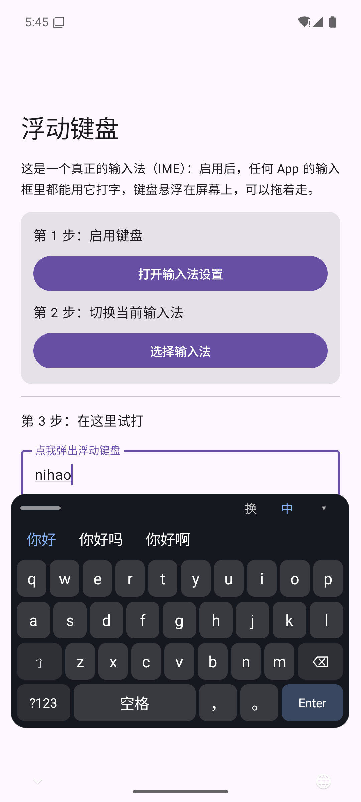

# 浮动键盘 FloatingKeyboard

一个**悬浮在屏幕上的虚拟键盘**，实现方式是真正的 Android 输入法（IME）。
启用后，任何 App 的输入框里都能用它打字，键盘面板浮在屏幕上、可拖动。

支持**中文（全拼 + 简拼）**和英文输入，选词会记录次数，越用越顺手。



## 为什么是输入法（IME），不是悬浮窗

「悬浮键盘」有三条路，这是 A 路线：

| 路线 | 能否往任意 App 输入 | 代价 |
|---|---|---|
| **A. 输入法 IME（本项目）** | ✅ 走官方 `InputConnection` | 用户需在设置里启用；只在输入框聚焦时出现 |
| B. 悬浮窗 + 无障碍注入 | ⚠️ 大部分可以 | 两个高危权限、部分 App 无效、难上架 |
| C. 自己 App 内的悬浮控件 | ❌ 只能自己用 | 几乎没有 |

A 的关键点：**输入法天生就是浮在所有应用之上的一个窗口**，只是默认贴在屏幕底部。
本项目的核心动作就是把它改成小尺寸、可拖动的浮动面板。

## 关键文件

```
app/src/main/
├── java/com/example/floatingkeyboard/
│   ├── FloatingIme.kt     ← 输入法本体：键盘布局 + 浮动窗口 + 拖动 + 输入逻辑
│   ├── PinyinDict.kt      ← 拼音词典：加载 assets/pinyin.txt，全拼/前缀/简拼查询
│   └── MainActivity.kt    ← 引导页：打开输入法设置、切换输入法、试打输入框
├── assets/pinyin.txt      ← 拼音词库（108,544 条，约 3 MB）
└── res/xml/method.xml     ← 输入法声明（subtype）
```

## 构建

```powershell
cd D:\code\floatkb
.\gradlew.bat :app:assembleDebug     # 调试包（debug 签名）
.\gradlew.bat :app:assembleRelease   # 正式包（自己的 keystore 签名 + R8 混淆）
```

| 产物 | 路径 | 大小 |
|---|---|---|
| debug | `app\build\outputs\apk\debug\app-debug.apk` | 12.8 MB |
| release | `app\build\outputs\apk\release\app-release.apk` | **2.36 MB** |

release 开了 `isMinifyEnabled` + `isShrinkResources`（R8），体积降到 18%。

## 应用图标

图标由 `tools/make-icon.ps1` 用 GDI+ 直接绘制生成，不依赖外部素材：

- 概念：一块**浮起来的浅色键盘面板**（带投影）+ 一个蓝色强调键
- **自适应图标**（API 26+）：`values/colors.xml` 的背景色 + `mipmap-xxxhdpi/ic_launcher_fg.png` 前景
- **旧版图标**（API 24-25）：`mipmap-*/ic_launcher.png` / `ic_launcher_round.png`，5 档密度
- 前景内容缩到 **0.72**，保证在圆形遮罩下不被裁切

改图标直接改脚本再跑一次：

```powershell
.\tools\make-icon.ps1
```

> 注意：自适应图标的前景不能顶满 108dp，内容要落在中间的安全区（圆形遮罩），
> 我试过 0.82 会被裁掉四角，0.72 正好。

## 签名

| 项 | 值 |
|---|---|
| 密钥库 | `keystore/floatkb-release.jks`（PKCS12，RSA 2048，有效期 30 年） |
| 别名 | `floatkb` |
| 口令 | 见 `keystore.properties`（已加入 `.gitignore`） |
| 证书 DN | `CN=FloatingKeyboard, OU=Personal, O=Personal, L=Beijing, ST=Beijing, C=CN` |
| 证书 SHA-256 | `5A:35:7F:F1:17:F6:91:7D:97:2F:19:95:D6:6B:6F:98:4C:EA:5B:27:8B:91:3B:DE:CF:33:44:20:6A:50:3C:9A` |
| 签名方案 | V2 + V3（未启用 V1：minSdk 24，Android 7.0 起用 V2 就够） |

校验签名：

```powershell
& "$env:ANDROID_HOME\build-tools\37.0.0\apksigner.bat" verify --print-certs app-release.apk
```

> ⚠️ **务必备份 `keystore/floatkb-release.jks` 和 `keystore.properties`**。
> 密钥库丢了就没法再给已安装的用户发更新——只能换包名，或让用户卸载重装。
> 也别提交到 Git（`.gitignore` 已经挡住了）。

## 安装与启用

```powershell
adb install -r app\build\outputs\apk\release\app-release.apk
adb shell ime enable com.example.floatkb/com.example.floatingkeyboard.FloatingIme
adb shell ime set    com.example.floatkb/com.example.floatingkeyboard.FloatingIme
```

⚠️ 不要在这之后 `adb shell am force-stop com.example.floatkb`——那会杀掉输入法进程，
系统会退回到上一个输入法，需要重新 `ime set`。

## 中文输入

| 能力 | 说明 |
|---|---|
| 全拼 | `nihao` → 你好 / 你好吗 / 你好啊 |
| 简拼 | `nh` → 你好 / 女孩 / 你会 / 你回 / 男孩 / 您好 |
| 前缀联想 | `ni` → 你 / 泥 / 你好 / 你们 … |
| 中英切换 | 顶部「中/En」按钮 |
| 自适应学习 | 选过的词次数 +1，查询时权重按 `1 + 0.5×次数` 放大，存 SharedPreferences |
| 缩放 | 上栏 `⤢` 左右拖动改大小（0.55× ~ 1.6×），按键高度/字号等比缩放，比例存本地 |
| 上屏方式 | 点候选 / 空格（取第一个候选） / 回车（原样上屏拼音） |
| 退格 | 点一下删一个；**按住不放连续删除**（380ms 后启动，每 55ms 删一个） |
| 标点 | `?123` 切**中文符号页**：数字 + ！？，。、；：""～ + （ ）《》…—·@#% |
| ASCII | 中文符号页右下角 `ASCII` 切**英文符号页**：`!"#$%&'()*` `+,-./:;<=>``?@[\]~\|_{}`，`中文` 键切回 |

候选栏用 `INVISIBLE` 占位（不是 `GONE`），所以打字时候选出现不会让键盘跳动。

### 界面布局

```
字母层                                符号层（?123 切换）
┌──────────────────────────┐        ┌──────────────────────────┐
│ ── 把手      ⤢ 换 中 ▾  │  ← 拖把手移动，拖 ⤢ 缩放        │ ── 把手      ⤢ 换 中 ▾  │  ← 拖把手移动，拖 ⤢ 缩放
├──────────────────────────┤        ├──────────────────────────┤
│ 你好  你好吗  你好啊 …   │        │ 1 2 3 4 5 6 7 8 9 0      │
│ q w e r t y u i o p      │        │ ！？，。、；：“”～        │
│ a s d f g h j k l        │        │ （）《》…—·@#%           │
│ ⇧ z x c v b n m ⌫        │        │                          │
│ ?123 空格 ， 。   Enter   │        │ ABC 空格 ⌫ ASCII Enter   │
└──────────────────────────┘        └──────────────────────────┘

ASCII 符号页（中文符号页点 ASCII 进入）
┌──────────────────────────┐
│ ! " # $ % & ' ( ) *      │
│ + , - . / : ; < = >      │
│ ? @ [ \ ] ~ | _ { }      │
│ ABC 空格 ⌫ 中文  Enter   │
└──────────────────────────┘
```

> **系统那两颗按钮（左下"收起"、右下"切换输入法"）怎么处理的**
>
> 它们是 SystemUI 画在**输入法窗口边缘**的，会跟着窗口走，App 改不了
> （`shouldOfferSwitchingToNextInputMethod()` 是 final 方法，重写不了）。
> 早期它们直接压在 `?123` 和 `Enter` 上，点一下就切走输入法。
>
> 最终解法：**把 IME 窗口做成全屏透明，面板只是浮在里面的一个小块**。
> 系统按钮于是被推到屏幕最底部的两个角，彻底离开键盘区域。
> 配合 `onComputeInsets()` 显式声明触摸区 = 面板矩形，屏幕其它地方仍然归 app。

### 词库来源与许可

词库由 `_dict/gen-dict.ps1` 从 [rime-ice](https://github.com/iDvel/rime-ice) 生成：

- 单字：8,544 条（《通用规范汉字表》+ 字频）
- 词条：100,000 条（华宇野风词库 / 清华 THUOCL / 现代汉语常用词表 / 腾讯词向量 合成）

重新生成：

```powershell
curl.exe -sL -o _dict\8105.yaml "https://cdn.jsdelivr.net/gh/iDvel/rime-ice@main/cn_dicts/8105.dict.yaml"
curl.exe -sL -o _dict\base.yaml "https://cdn.jsdelivr.net/gh/iDvel/rime-ice@main/cn_dicts/base.dict.yaml"
.\_dict\gen-dict.ps1
```

⚠️ **许可提醒**：rime-ice 是 GPL-3.0，其上游词表（THUOCL 等）各有各的许可。
自己用没问题；**要上架商店需逐项核对许可证**，或换成自建词库。

## 实现过程中踩的坑（都很典型）

### 1. 键盘根本不弹出来

日志里 `onShowInputRequested(flags=1) -> false`。
默认实现会检查 `onEvaluateInputViewShown()`，如果系统认为**接了物理键盘**就拒绝弹软键盘，
模拟器/平板/外接键盘场景都会命中。解决办法（Gboard 也是这么做的）：

```kotlin
override fun onEvaluateInputViewShown(): Boolean = true
```

### 2. 改了窗口属性，键盘变成不可见窗口

在 `onStartInputView()` 里设 `window.attributes` 会被系统在显示窗口时重置，
结果是窗口存在但看不见（`mWindowVisible=false` 而 `mIsInputViewShown=true`）。
必须等窗口真正显示后再改：

```kotlin
override fun onWindowShown() {
    super.onWindowShown()
    window?.window?.decorView?.post { applyFloatingLayout() }
}
```

### 3. 拖动时每帧 `setAttributes` 会让窗口反复重排甚至消失

改成拖动中只累计 `posX/posY`，**松手时一次性提交**，并做屏幕边界钳制。

### 4. 全屏窗口后键盘突然点不动了

把 IME 窗口改成全屏，`onComputeInsets()` 里把 `contentTopInsets` 设成屏幕高度后，
系统算出的触摸区变成 `(0,2274,1080,2400)`——只有屏幕最底下一条，键盘完全没反应。

正解是**同时**显式指定触摸区（坐标是窗口相对的，别加状态栏高度）：

```kotlin
outInsets.contentTopInsets = dm.heightPixels   // app 不要被挤压
outInsets.visibleTopInsets = dm.heightPixels
outInsets.touchableInsets  = Insets.TOUCHABLE_INSETS_REGION
outInsets.touchableRegion.set(posX, posY, posX + panelWidth, posY + panelHeight)
```

### 5. 中/英状态和标签会不同步

`zhMode` 是服务的字段，但上栏的「中/En」按钮文字是**写死 "中"** 的。
只要输入法视图被重建（换输入框、改尺寸、系统重排），按钮就回到「中」，
实际却还是英文——看着是中文，打字出英文。

修复：按钮文字和颜色都从 `zhMode` 当前值初始化，而不是写常量。

### 6. 词典加载 108k 条要 ~900ms

放到 `onCreate()` 的后台线程预热，避免第一次按键卡顿。
如果后续词库更大，应改成首屏只加载单字、词条按需加载。

## 平板适配

- 面板宽度按 **dp 封顶 480dp**：手机上还是 94% 屏宽，平板上不会铺满整块屏幕
- 上栏 `⤢` 可拖动缩放，`ui_scale` 存 SharedPreferences，重开键盘保持
- 缩放上限 1.6×、下限 0.55×，超出会自动钳制，位置也在重新布局后再钳一次，避免超出屏幕

> 实测环境：10.1" 1280×800 横屏 AVD（`Tablet10`），缩放、中文输入、拖动、连删均正常。

## 已知限制

- 输入法**不能主动弹出**，必须用户点输入框（系统限制）
- 符号只有 `，` `。` `.` 三个，没有完整符号层；没有长按变音、没有 emoji
- 没有真正的"整句输入"——只做前缀匹配，不做分词和语言模型
- 面板宽 94%，横向拖动余量只有几十像素
- 系统会在输入法窗口左右下角各画一个图标（切换输入法 / 收起），二者**不可点击但会占位**，
  所以底排两端必须留白；上栏的「换」「▾」才是我们自己的按钮
- 词库许可需自行核对（见上）

## 可以继续加的功能

1. **符号层**：`?123` 切换到数字/标点页
2. **长按弹出**：长按字母出 á à 之类变体
3. **记忆位置**：把 `posX/posY` 存 SharedPreferences
4. **系统用户词典**：通过 `UserDictionary` API 与系统"个人词典"打通
5. **导入词库**：支持导入 txt/csv，进阶支持解析搜狗 `.scel`（注意版权，仅供自用）


